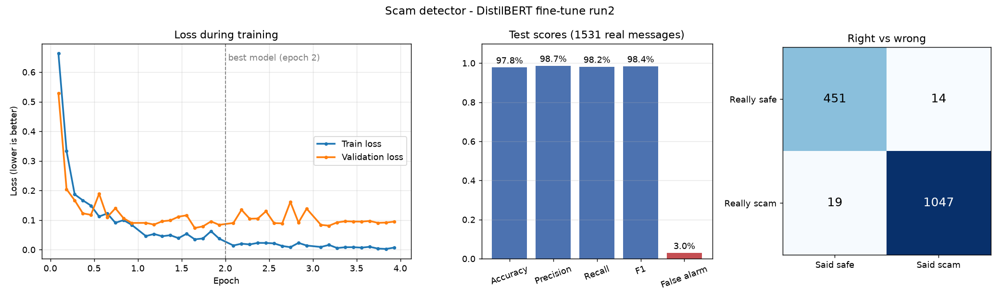

# Scam Detector

A small, open-source model that reads a text message and says **SCAM** or **SAFE**.

It is a fine-tuned [DistilBERT](https://huggingface.co/distilbert/distilbert-base-uncased) model trained on real scam reports from around the world, real everyday SMS, and written safe service messages (OTP codes, bank alerts, deliveries and more). It runs on a normal laptop, so messages never need to leave your device.

**Version 1.0.0** · English only · Code: MIT · Data: CC BY 4.0

```
$ python predict.py "USPS: Your package is on hold. Update your address within 12 hours: usps-redeliver.top/track"

🚨 SCAM  (98% scam)
  Model saw: USPS: Your package is on hold. Update your address within 12 hours: <URL>
```

## Results

Tested once on **1,531 real messages** that the model never saw during training:

| Metric | Score | Meaning |
|---|---|---|
| Accuracy | 97.8% | All answers right |
| Precision | 98.7% | When it says scam, how often it is right |
| Recall | 98.2% | Share of scams caught (1,047 of 1,066) |
| F1 | 98.4% | Balance of precision and recall |
| False alarm rate | 3.0% | Safe messages wrongly flagged (14 of 465) |



Full report: [`results/run2/results.html`](results/run2/results.html) (open in a browser) · every mistake: [`results/run2/test_mistakes.csv`](results/run2/test_mistakes.csv)

### Read this before trusting the numbers

The test set above has real scams but only **personal chats** as safe messages. On a separate hand-made set of 60 harder messages, the model got **51 of 60** right and flagged **7 of 28** real service messages as scams. See [Known limitations](#known-limitations).

## Quick start

Needs Python 3.10+ (tested on 3.14, macOS, Apple Silicon).

```bash
git clone https://github.com/Mohamedrasheq/scam-shield.git
cd scam-shield
python -m venv .venv
source .venv/bin/activate
pip install -r requirements.txt
```

The trained model is not stored in this repo (it is 256 MB). Either train it yourself (below, about 12 minutes on a laptop GPU), or download it from Hugging Face once it is published there.

## Check messages

```bash
# One message
python predict.py "Hi Mum, I dropped my phone, this is my new number. Can you send me \$300 today?"

# Type or paste messages one by one (multi-line pastes work). Type q to quit.
python predict.py
```

You see the verdict, how sure the model is, and the message as the model saw it after masking (links, phone numbers and long numbers are replaced with tags). Messages under 3 words are reported as too short to judge.

## Train it yourself

```bash
python clean_data.py   # data/raw/      -> data/processed/clean.csv
python split_data.py   # clean.csv      -> data/splits/train|val|test.csv
python finetune.py     # splits         -> models/scam-distilbert-run2/ + results/run2/
python make_report.py run2   # results  -> results/run2/results.html
```

`finetune.py` downloads the base model from Hugging Face if it is not in `models/`. It uses the Apple GPU (MPS), an NVIDIA GPU (CUDA) or the CPU, whichever is available. Peak memory is about 7 GB.

| Setting | Value |
|---|---|
| Base model | distilbert-base-uncased (67M parameters, all trained) |
| Max length | 128 tokens |
| Batch size | 16 |
| Learning rate | 2e-5, 10% warm-up, then linear decay |
| Epochs | up to 4, early stop after 2 epochs without validation improvement |
| Best epoch (run 2) | 2 |

## How it works

1. **Clean** (`text_utils.py`): fix broken characters, then mask links, phone numbers, emails and long numbers, so `www.bank-verify.top` and `bit.ly/x` both become `<URL>`.
2. **Read:** DistilBERT turns the message into a 768-number summary of its meaning.
3. **Decide:** a small classification head turns that summary into two scores, safe and scam. Above 50% scam means **SCAM**.

## Data

| Source | Messages used | Label | License |
|---|---|---|---|
| [IMC 2025 smishing reports](https://github.com/reportsmishing/Smishing-Dataset-IMC25) | 10,325 | scam | CC BY 4.0 |
| [Mishra & Soni SMS phishing](https://data.mendeley.com/datasets/f45bkkt8pr/1) | 4,647 safe, 334 scam | both | CC BY 4.0 |
| Synthetic safe service messages (this project) | 4,955 | safe | CC BY 4.0 |

Spam (ads) is left out on purpose: the model answers "is this a scam?", not "is this unwanted?". Details on cleaning, masking, de-duplication and the split: [`data/README.md`](data/README.md).

## Known limitations

- **English only**, trained mostly on SMS-style messages. Emails and long chat messages are outside what it has learned.
- **Too suspicious of real alerts.** Real fraud alerts, password resets, bills due, salary credits and long bank notices can be flagged as scams.
- **Long, multi-line messages** lean towards SCAM, because long safe messages are rare in the training data.
- **Some scams slip through:** slow, friendly romance scams, and very short "account blocked, call this number" messages with no link.
- **Label noise:** about 10–20% of the public scam reports are real messages that users were unsure about.
- **It is a helper, not a guarantee.** Never treat a SAFE result as proof that a message is safe.

## Roadmap

- Log errors from wider testing, then add training data for each error pattern.
- Real safe service messages in the test set.
- More languages (multilingual base model).
- Smaller model for browsers and phones.

## Project layout

```
text_utils.py     shared cleaning and masking (training and live checks)
clean_data.py     build data/processed/clean.csv from data/raw/
split_data.py     build data/splits/ (train / val / test)
finetune.py       fine-tune DistilBERT, test once, save results
make_report.py    build the HTML results page for a run
predict.py        check messages live
data/             datasets and their licenses (see data/README.md)
results/run2/     scores, mistakes, graphs and log for the released model
```

## Credits

- **Datasets:** Agarwal, Papasavva, Suarez-Tangil and Vasek (IMC 2025); Mishra and Soni (Mendeley Data, 2022). Full citations in [`data/README.md`](data/README.md).
- **Base model:** DistilBERT by Hugging Face (Sanh et al., 2019), Apache-2.0.

## License

Code: [MIT](LICENSE). Data: CC BY 4.0 (credit the original authors). Base model: Apache-2.0.
